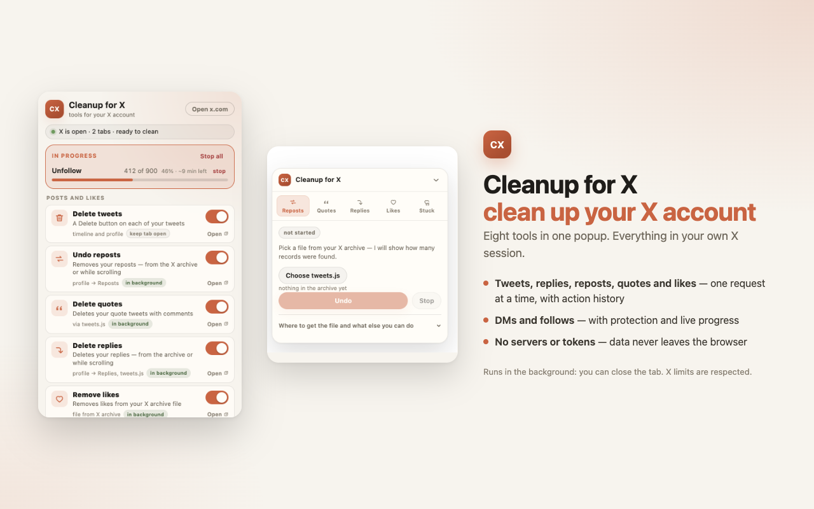
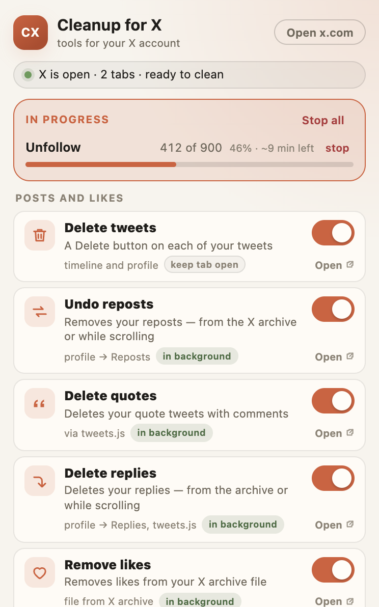
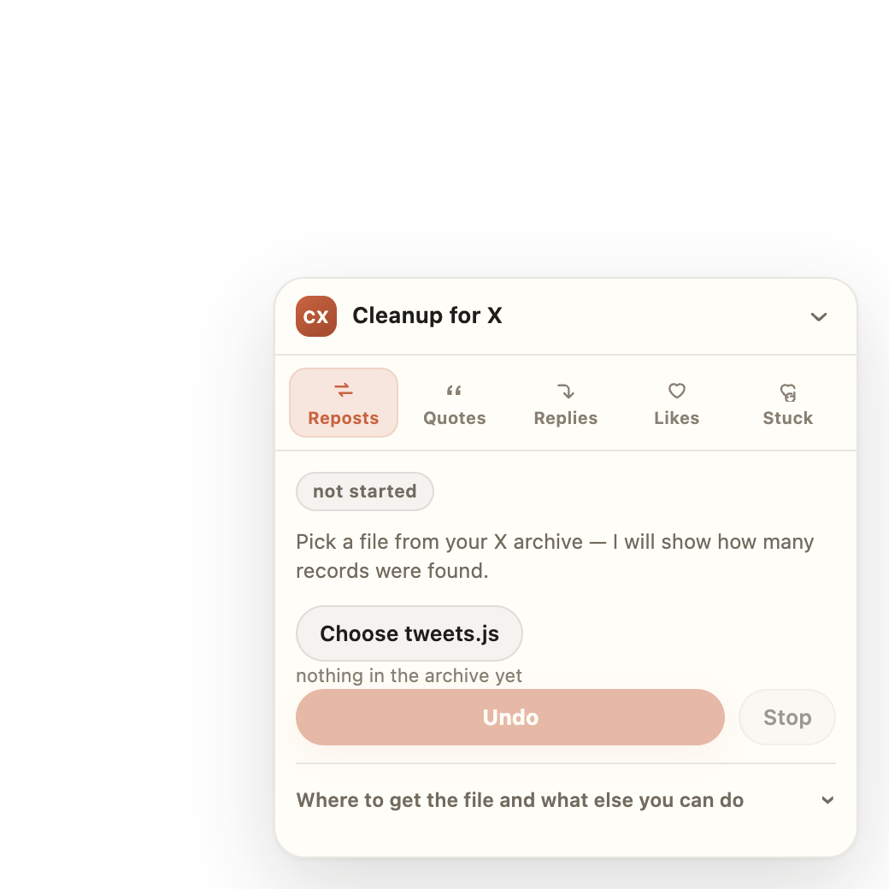

# Cleanup for X — clean up your X account

**English** · [Русский](README.ru.md)

A Chrome extension (Manifest V3) with eight cleanup tools for your X account in one
popup. It deletes your tweets, reposts, quotes and likes, cleans up direct
messages, unfollows people who do not follow you back and removes posts that
stayed in Likes without a like.

Everything runs in your existing X session, and requests go only to `x.com`. The
protect list and the action history live in the extension storage. Cleanup for X
is not affiliated with X Corp.; use it at your own risk and within X rules.



| Popup | Dock on an X page |
|---|---|
|  |  |

The dark theme is in [`docs/popup-dark.png`](docs/popup-dark.png), the whole popup
in [`docs/popup-full.png`](docs/popup-full.png).

The interface is bilingual: English by default, Russian automatically when the
browser language is Russian. Both languages live in `shared/i18n.js`; the popup
preview can be forced with `?lang=ru` or `?lang=en`.

## Contents

- [What is inside](#what-is-inside)
- [Install](#install)
- [How to use](#how-to-use)
- [Live data: no need to reload the popup](#live-data-no-need-to-reload-the-popup)
- [Modules](#modules)
- [X archive: where to get the files](#x-archive-where-to-get-the-files)
- [Who to leave alone](#who-to-leave-alone)
- [History and moving data](#history-and-moving-data)
- [Privacy and permissions](#privacy-and-permissions)
- [Limitations](#limitations)
- [Troubleshooting](#troubleshooting)
- [Development](#development)

## What is inside

| Part | Where | How it works |
|---|---|---|
| **Popup** | extension icon | eight module cards, live queues, protect list, history, export/import |
| **Dock on the page** | bottom right corner of x.com | tabs for enabled modules, progress, event log, “stop all”; the header shows what is running even when the dock is collapsed |
| **Background engine** | service worker | unfollow, reposts, quotes and likes run in the background: you can close the tab and the queue continues from the same place. Stuck likes run synchronously with the tab open: the panel puts and removes one like at a time |

The popup and the page panels use large cards and short sentences: every module says
what it does, where it works and what will happen when you start it. You can see
the look without installing anything by opening
[`design/popup-preview.html`](design/popup-preview.html) in a browser (demo data).

## Install

1. Download the archive: [Releases → `cleanup-for-x-1.14.0.zip`](https://github.com/vi468/cleanup-for-x/releases)
   or use “Code → Download ZIP” on the repository page and unpack it. A `git clone`
   works too — just point Chrome at that folder.
2. Open `chrome://extensions` and turn on **Developer mode**.
3. **Load unpacked** → choose the `cleanup-for-x` folder (it must contain
   `manifest.json`).
4. Pin the icon to the toolbar: extensions menu → three dots → “Pin”.
5. Open `x.com` and sign in. The popup will say “X is open · N tabs”.

Works in Chrome, Edge, Brave, Vivaldi and other Chromium browsers (version 114+).

## How to use

1. **Turn on the modules you need** in the popup. Changes are saved immediately
   and open X tabs reload by themselves, so the module appears on the page.
2. **Open the X page** you want to clean. Every card in the popup has an “Open”
   button that takes you to the right page.
3. **Work in the panel at the bottom right**: start, progress, “Stop” and the log
   live there. You can close the popup.

Deletion is permanent: X has no trash bin. Before big runs, check the limits
below and the protect list.

## Live data: no need to reload the popup

The popup subscribes to `chrome.storage` changes and X tab events. History
counters grow while the work is running, not after a restart, and queue progress
updates on every step. A toggle changed elsewhere turns off by itself, and the
“X is open · N tabs” line changes when you open or close X. If a queue stops
(rate limit, 429, 404), the popup shows a notice with the reason.

This is covered by `test/popup.test.js` (jsdom) and checked on a live extension:
writing to `chrome.storage` updates the DOM without a reload.

## Modules

### Delete tweets

On any X page each of your tweets gets a **Delete** button next to reply and
repost. Other people’s tweets and reposts are left alone. Deletion uses the same
request as X’s own button (`DeleteTweet`) and does not need the dock. The tab has
to stay open.

### Undo reposts

Two ways:

- **`tweets.js` from your X archive** — the full list of pure reposts for all time;
- **“Undo while scrolling”** — open your profile’s Reposts tab and simply scroll:
  the extension undoes reposts one by one without running ahead. Records already
  undone (from history) are skipped immediately, without waiting.

Quotes and your own regular tweets are not touched; they have their own tools.
The queue runs in the background; you can close the tab.

### Delete quotes

A quote is your own tweet with a comment and someone else’s post embedded. The
module takes `tweets.js` from the archive, keeps records with
`is_quote_status: true` and deletes them through `DeleteTweet`. Reposts and
regular tweets stay. Runs in the background.

### Delete replies

A reply is your own tweet with `in_reply_to` set, shown in the interface as
“Replying to @someone”. The module takes `tweets.js` from the archive, keeps
records with `in_reply_to_status_id_str`, `in_reply_to_user_id_str` or
`in_reply_to_screen_name` and deletes them through `DeleteTweet`. Regular tweets
and reposts stay.

Without the archive: open your profile’s Replies tab and scroll. Each card is
queued and deleted one at a time, the same way reposts are undone. The tab has to
stay open, and it only reaches what X has already rendered.

### Remove likes

Takes `like.js` from your X archive. That file lists every like, including ones
no longer in the timeline, and the module removes them one by one
(`UnfavoriteTweet`). Runs in the background. On 429 the queue waits for the X
limit to reset and continues.

### Stuck likes

Sometimes a like is already gone, but the post still sits in History → Likes with
an empty heart: X kept the row. An ordinary unlike does not fix it. Doing it by
hand, like and unlike again, makes the row disappear, and the module repeats that
pair for every post it finds.

1. Open History → Likes (`x.com/i/history/likes`); the old profile address
   `x.com/<handle>/likes` works too.
2. Press **Find and remove**. The panel walks every card and immediately sends
   the pair of requests: for a stuck row it puts and removes the like, for a card
   whose like is still there it just removes it. The pair goes without a pause,
   and after the answer the row is removed from the list so you can see it was
   processed.
3. Keep the tab open: the panel walks the list synchronously, one post at a time.
   To check the result, reload the Likes page.

Before you run it:

- **it walks every post in the list**, including ones whose like is still there
  and removes those too. If you want to keep a like, do not run it;
- every stuck post gets a like for a moment — **the author may see a notification**;
- the panel removes the row right after the answer; if it comes back after F5,
  that is X state, not the extension;
- X limits how often you can like: on 429 the queue waits by itself, and thousands
  of rows mean hours;
- “Stop” ends the run and the queue; the next run starts from the current place,
  already processed rows are skipped;
- the list has to be scrolled for real: ids come only from the page, there is no
  other way for the extension to enumerate Likes;
- the module history is cleared before every run: if a row stayed after an X error
  or came back after a reload, the next run processes it again instead of
  skipping it as “already done”.

### Clean up DMs

On `x.com/i/chat` the panel deletes conversations the same way a human would:
menu → “Delete conversation” → confirm. Groups are not touched by default; there
is a checkbox to leave them. A conversation disappears for you; the other
person keeps a copy. This one runs only while the tab is open.

### Unfollow

On the Following page every row gets a circle. The circle appears only for people
who do not follow you back: mutual follows and the protect list cannot be
selected.

- click selects one row, Shift+click selects a range;
- “Select visible” — everyone not following back on screen;
- “×” next to a row or Alt+click on the circle — unfollow immediately;
- “Unfollow” — queue the selected rows;
- **from the archive** — load `following.js` and `follower.js`, the extension
  calculates non-followers itself and unfollows them. Runs in the background; you
  can close the tab.

## X archive: where to get the files

1. X → “More” → **Settings and privacy** → “Your data” →
   **“Download an archive of your data”**.
2. X emails you a link to a zip. Inside there is a `data` folder:
   - `tweets.js` — tweets, reposts and quotes (for reposts and quotes);
   - `like.js` — likes;
   - `following.js` — who you follow;
   - `follower.js` — who follows you.
3. Choose the file in the module panel. The list is kept in the extension and
   survives page reloads; the line shows “loaded 14.11, 06:44”.

Large accounts get files in parts (`tweets-part1.js`, `-part2`). You can load
several; the lists are merged. The archive is a snapshot: if someone followed
you after it was generated, X will not show that in the file.

## Who to leave alone

The unfollow protect list lives in the popup: the **“Who to leave alone”** block.

- **Add from text** — paste anything: `x.com/…` and `twitter.com/…` links
  (including `intent/follow?screen_name=`), `@handles`, bare handles line by
  line, numeric ids. Only X accounts are extracted; everything else is dropped.
- **Add manually** — the `@handle, link or id` field and “Add”.
- **Remove** — the cross on a chip.
- **Clear all** — with confirmation.

Changes are picked up on an open X page without a reload: the row immediately
gets a shield and is removed from the selection. The list is shared by the popup
and the page.

> If you are upgrading from an older version, the list may still contain a large
> set of handles from the previous build. New users no longer get it
> automatically; the old list can be checked and cleared with “Clear all”.

## History and moving data

Every module remembers what it has already done (`chrome.storage.local`, key
`история`): unfollows by account id, removed reposts, quotes, likes and stuck
likes by record id, conversations by dialog id. The limit is 20,000 ids per
module.

Why: runs are large and easily interrupted. A second run:

- unfollow — the queue skips accounts already unfollowed; the archive line shows
  “already undone N”;
- reposts — the archive subtracts records undone earlier;
- likes, stuck likes and quotes — finished work is not repeated;
- tweets and DMs — records go to history as they are deleted, so you can see how
  much is done.

The **“What has been done”** block has eight rows with counters and a “clear”
button for each. Clearing does not bring anything back. The extension just stops
remembering those records.

**Export to file** and **Import from file** move history, the protect list and
loaded archive lists to another browser. Import *merges* data and overwrites
nothing; a foreign JSON is rejected.

## Privacy and permissions

The extension sends nothing anywhere except `x.com` and contains no analytics.

| Permission | Why |
|---|---|
| `storage` | module settings, history, protect list, loaded archives |
| `cookies` | read the `ct0` cookie and send X requests as you; without it the background queue cannot work with the tab closed |
| `host_permissions` `x.com`, `twitter.com` | requests to X and page layout |

How it behaves:

- requests use your cookies, so they act as your account, as if you pressed the
  buttons yourself;
- nothing is posted and nothing is sent in direct messages;
- data is stored only in the browser; delete it with “Clear all” / “clear” in
  history or by removing the extension.

The policy text is in [`docs/privacy.html`](docs/privacy.html).

## Limitations

- **X limits.** Mass actions hit platform limits: 50–100 unfollows per run is
  fine, thousands a day means a temporary action block. Likes: about 500 removals
  per 15 minutes. On 429 the queue waits according to `x-rate-limit-reset` and
  continues; after five 429s in a row it stops. Stuck likes take two requests per
  row, so the queue moves slower and makes a long pause every 500 steps.
- **Hidden tab.** Browsers throttle timers in inactive tabs. DMs and tweet delete
  buttons work only while the tab is open; unfollow, reposts, quotes and likes run
  in the background through the service worker. Stuck likes need the tab only
  while collecting; the cleanup runs in the background.
- **X layout changes.** Selectors are written for the autumn 2026 build. If X
  redesigns the page, the panel stays but an action may fail to find a button —
  see the section below.
- **Deletion is only on your side.** Conversations and messages disappear from
  your view; the other person keeps a copy.
- **The archive is a snapshot.** Mutuality is calculated from
  `following.js`/`follower.js` at export time.

## Troubleshooting

1. **A module did not appear.** Check that it is on in the popup and reload the X
   tab (the extension reloads it itself when you flip the toggle).
2. **The panel cannot see rows** (“not found”, “I cannot see the conversation
   list”). Most likely X changed the layout. Open the console and list the
   `data-testid` values on the page:

   ```js
   [...document.querySelectorAll('[data-testid]')].map(el => el.dataset.testid)
   ```

   Compare with what the modules look for: `UserCell`, `*-unfollow`,
   `confirmationSheetConfirm`, `dm-conversation-item-*`.
3. **404 in the log.** X changed a GraphQL `queryId`. The delete button looks for
   a fresh id in page bundles itself; if the background still stops, reload X and
   start again.
4. **429.** X rate limit. Wait 15–20 minutes; the queue continues from the same
   place.
5. **Not sure what is happening.** The dock has a log: recent events with time and
   tone. The popup shows a notice with the reason.

## Development

```sh
npm install          # jsdom and eslint
npm test             # 9 test files: engine, history, protect, storage, dock, ghost, modules, i18n, popup
npm run lint         # undeclared names, duplicate declarations
```

There is no build step: the extension loads as a folder. Style: vanilla JS,
Russian identifiers and comments (the interface is bilingual).

### Structure

```
manifest.json
_locales/{en,ru}              localized extension name and description
LICENSE                        MIT
CHANGELOG.md                   what changed by version
background/service-worker.js   router: settings, tab reload, jobs
background/queue.js            one queue engine: unfollow, reposts, quotes, likes, stuck likes
background/store.js            storage schema, migrations, export/import
shared/i18n.js                 interface dictionary (English + Russian)
shared/modules.js              module dictionary: titles, descriptions, icons, order
shared/gate.js                 content-script entry: waits for settings, starts modules
shared/dock.js                 one dock with tabs, log and work status
shared/archive-job.js          shared panel “archive file → background → progress”
shared/ui.css                  tokens and components for dock/panels (xc-*)
shared/protect.js              “who to leave alone”: parse any text + storage
shared/history.js              action history per module
shared/xqid.js                 current queryId and x-client-transaction-id
content/tweets.js              delete your tweets
content/reposts.js             undo reposts from archive and while scrolling
content/quotes.js              delete your quotes
content/replies.js             delete your replies (archive or Replies tab)
content/likes.js               remove likes
content/ghost-likes.js         stuck likes: collect from the Likes page
content/dms.js                 clean up conversations
content/unfollow.js            unfollow with selection and protection
popup/                         popup: modules, live queues, protect, history
design/popup-preview.html      popup preview without installing (demo data)
design/icon.html               extension icon source
design/store-shot.html         source for the 1280×800 store screenshot
docs/privacy*.html, docs/*.png  privacy policy and screenshots
test/                          jsdom tests, X fixtures and the i18n dictionary test
```

### Live updates in the popup

The popup does not “snapshot” the state on open. It reads the initial state once
and then subscribes to:

- `chrome.storage.onChanged` (`local`: `история`, `защита`, `задания`;
  `sync`: toggles);
- tab events (`chrome.tabs.onCreated/onRemoved/onUpdated/onActivated`).

While a job is running, a fallback poll runs every 3 seconds in case an event was
lost. The subscription always comes first.

### If X changes its layout

Selectors live at the top of `content/*.js` files. Layout changes break the
modules that click through the DOM (DMs, the Delete button) and the collection of
stuck likes; the background queues for unfollow, reposts, quotes, likes and the
stuck-like pairs work by record ids. The stuck-like detector already understands
both known markups: the old one and `x-web` 2026.

### Language

The interface dictionary is `shared/i18n.js`. Each module adds its own strings
next to the code with `XCI18n.добавить({ ru: {...}, en: {...} })`. English is the
default; Russian turns on automatically when the browser language starts with
`ru`. You can force it in the preview with `?lang=ru` / `?lang=en`. Manifest
strings are localized with `_locales/en` and `_locales/ru`.

## License

MIT — see [LICENSE](LICENSE). Cleanup for X is not affiliated with X Corp. and uses
only your X session; mass actions hit platform limits, so use it at your own risk.
