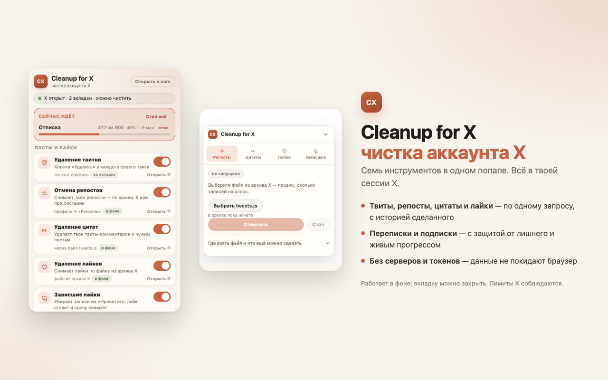
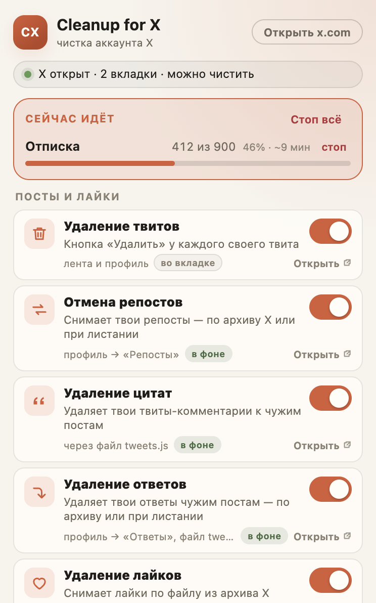
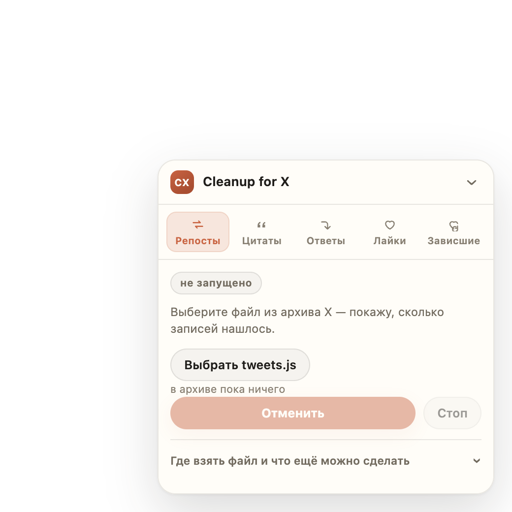

# Cleanup for X — чистка аккаунта X

[English](README.md) · **Русский**

Расширение для Chrome (Manifest V3): восемь инструментов чистки профиля X в одном
попапе. Удаляет свои твиты, репосты, цитаты и лайки, чистит переписки и
«Нравится» (включая записи, у которых лайка уже нет), отписывается от тех, кто
на тебя не подписан.

Никаких серверов, токенов и аналитики: всё работает в твоей же сессии X, запросы
уходят только на `x.com`. Список «кого не трогать» и история сделанного лежат в
хранилище расширения. Расширение не аффилировано с X Corp.: используй его на свой
риск и в рамках правил X.



| Попап | Док на странице X |
|---|---|
|  |  |

Тёмная тема — [`docs/popup-dark.ru.png`](docs/popup-dark.ru.png), весь попап
целиком — [`docs/popup-full.ru.png`](docs/popup-full.ru.png).

## Содержание

- [Что внутри](#что-внутри)
- [Установка](#установка)
- [Как пользоваться](#как-пользоваться)
- [Живые данные: попап не нужно перезагружать](#живые-данные-попап-не-нужно-перезагружать)
- [Модули](#модули)
- [Архив X: где взять файлы](#архив-x-где-взять-файлы)
- [Кого не трогать](#кого-не-трогать)
- [История и перенос данных](#история-и-перенос-данных)
- [Приватность и разрешения](#приватность-и-разрешения)
- [Ограничения](#ограничения)
- [Если что-то пошло не так](#если-что-то-пошло-не-так)
- [Разработка](#разработка)

## Что внутри

| Что | Где | Как работает |
|---|---|---|
| **Попап** | иконка расширения | восемь карточек модулей, живые очереди, «кого не трогать», история, экспорт/импорт |
| **Док на странице** | правый нижний угол x.com | вкладки по включённым модулям, прогресс, журнал событий, «стоп всё»; в шапке видно, что идёт, даже если док свёрнут |
| **Фоновый движок** | service worker | отписка, репосты, цитаты и лайки идут в фоне: вкладку можно закрыть, очередь продолжится с того же места. Зависшие лайки идут синхронно с открытой вкладкой: панель ставит и снимает лайк по одному |

Интерфейс двуязычный: английский по умолчанию, русский включается сам, если язык
системы или браузера русский. Строки живут в `shared/i18n.js`, название и описание
расширения — в `_locales/`. Русскую версию в предпросмотре можно включить
параметром `?lang=ru`. Крупные карточки и простые слова: у каждого модуля
написано, что он делает, где работает и что произойдёт при запуске. Внешний вид
без установки — [`design/popup-preview.html`](design/popup-preview.html) в
браузере (данные демонстрационные).

## Установка

1. Скачай архив: [Releases → `cleanup-for-x-1.14.0.zip`](https://github.com/vi468/cleanup-for-x/releases)
   или «Code → Download ZIP» на странице репозитория, и распакуй его. Можно и
   `git clone` — тогда просто укажи папку репозитория.
2. Открой `chrome://extensions` и включи **Режим разработчика**.
3. **Загрузить распакованное расширение** → выбери папку `cleanup-for-x`
   (внутри должен лежать `manifest.json`).
4. Закрепи иконку на панели инструментов: меню расширений → три точки → «Закрепить».
5. Открой `x.com` и залогинься. В попапе будет написано «X открыт · N вкладок».

Подходит для Chrome, Edge, Brave, Vivaldi и других браузеров на Chromium
(версия 114+).

## Как пользоваться

1. **Включи нужные модули** в попапе. Изменения сохраняются сразу, открытые
   вкладки X перезагружаются сами — модуль появляется на странице.
2. **Открой страницу X**, где будешь чистить. У каждой карточки в попапе есть
   кнопка «Открыть» — она ведёт на нужную страницу.
3. **Работай в панели внизу справа**: там запуск, прогресс, «Стоп» и журнал.
   Попап при этом можно закрыть.

Удаление необратимо: в X нет корзины. Перед большими проходами проверь лимиты
(ниже) и список «кого не трогать».

## Живые данные: попап не нужно перезагружать

Попап подписан на изменения `chrome.storage` и на вкладки X, поэтому:

- счётчики истории растут прямо во время работы, а не после перезапуска;
- прогресс фоновой очереди обновляется каждым шагом;
- тумблер, выключенный в другом месте, гаснет сам;
- строка «X открыт · N вкладок» меняется, когда ты открываешь или закрываешь X;
- если очередь встала (лимит, 429, 404), в попапе появляется плашка с причиной.

Это проверено автотестом `test/popup.test.js` (jsdom) и на живом расширении:
запись в `chrome.storage` меняет DOM без перезагрузки.

## Модули

### Удаление твитов

На любой странице X у твоих твитов появляется кнопка «Удалить» рядом с ответом и
репостом. Чужие твиты и репосты не трогаются. Удаление идёт тем же запросом, что
и у кнопки X (`DeleteTweet`), и не требует открытого дока. Работает, пока
открыта вкладка.

### Отмена репостов

Два пути:

- **файл `tweets.js` из архива X** — полный список чистых репостов за всё время;
- **«Отменять при листании»** — открой свой профиль на вкладке «Репосты» и просто
  листай: расширение снимает репост за репостом, по одному, не убегая вперёд.
  Уже снятые записи (из истории) пропускаются сразу, без ожидания.

Цитаты и свои обычные твиты модуль не трогает — для них отдельные инструменты.
Очередь живёт в фоне, вкладку можно закрыть.

### Удаление цитат

Цитата: свой твит с комментарием и вложенным чужим постом. Модуль берёт
`tweets.js` из архива, оставляет записи с `is_quote_status: true` и удаляет их
через `DeleteTweet`. Репосты и обычные твиты не трогаются. Работает в фоне.

### Удаление ответов

Ответ — свой твит с полем `in_reply_to`, в интерфейсе он подписан «В ответ
@ник». Модуль берёт `tweets.js` из архива, оставляет записи с
`in_reply_to_status_id_str`, `in_reply_to_user_id_str` или
`in_reply_to_screen_name` и удаляет их через `DeleteTweet`. Обычные твиты и
репосты не трогаются.

Без архива: открой свой профиль на вкладке «Ответы» и листай. Каждая карточка
уходит в очередь и удаляется по одной, так же как снимаются репосты. Вкладка
должна быть открыта, и достаётся только то, что X успел отрисовать.

### Удаление лайков

Берёт `like.js` из архива X (там все лайки, включая те, что уже не достать из
ленты) и снимает их по одному (`UnfavoriteTweet`). Работает в фоне. На 429
очередь сама ждёт, пока лимит X отпустит, и продолжает.

### Зависшие лайки

Бывает, что лайк уже снят, а пост всё ещё висит в «История → Нравится» с пустым
сердцем: запись осталась в списке на стороне X. Обычное снятие лайка такое не
лечит. Ручная пара «поставить и снять» запись убирает, и модуль повторяет её для
всех найденных постов.

1. Открой «История → Нравится» (`x.com/i/history/likes`); старый адрес профиля
   `x.com/<ник>/likes` тоже подходит.
2. Нажми **«Найти и убрать»**. Панель идёт по всем карточкам списка и для каждой
   сразу отправляет пару запросов: у зависшей ставит и снимает лайк, у карточки,
   где лайк ещё стоит, просто снимает. Пара уходит без паузы, а после ответа
   строка убирается из списка — видно, что она обработана.
3. Вкладку надо держать открытой: панель ведёт список синхронно, по одному
   посту. Проверить результат — обновить страницу «Нравится».

Детали работы:

- **модуль пройдётся по всем постам списка**, включая те, где лайк ещё стоит, —
  снимет и их. Если какой-то лайк нужно сохранить, не запускай;
- на каждый зависший пост на миг ставится лайк — **автор может увидеть уведомление**;
- строку из списка панель убирает сразу после ответа; если после F5 она вернулась —
  это уже состояние X, а не расширения;
- X ограничивает частоту лайков: на 429 очередь ждёт сама, а тысячи записей —
  это часы;
- «Стоп» останавливает проход и очередь; следующий запуск начнётся с текущего
  места, уже обработанные записи пропускаются;
- листать список придётся вживую: id берутся только со страницы, другого способа
  перечислить «Нравится» у расширения нет;
- перед каждым запуском история модуля очищается: если строка осталась висеть
  после ошибки X или вернулась после обновления, следующий запуск снова её
  обработает, а не пропустит как «уже сделано».

### Чистка переписок

На `x.com/i/chat` панель удаляет переписки так же, как это делают руки:
меню → «Удалить переписку» → подтверждение. Группы по умолчанию не трогаются,
для них есть галочка «выйти и из групп». Диалог исчезает у тебя; у собеседника
копия остаётся. Работает, пока вкладка открыта.

### Отписка

На странице «Подписки» у каждой строки появляется кружок. Кружок есть только у
тех, кто на тебя не подписан: взаимные подписки и список «кого не трогать»
выделить нельзя.

- клик — выбрать одну строку, Shift+клик — отрезок;
- «Выбрать видимых» — все невзаимные на экране;
- «×» рядом со строкой или Alt+клик по кружку — отписаться сразу;
- «Отписаться» — очередь по выбранным;
- **по архиву** — загрузи `following.js` и `follower.js`, расширение само посчитает
  невзаимных и отпишется. Работает в фоне, вкладку можно закрыть.

## Архив X: где взять файлы

1. X → «Ещё» → **Настройки и настройки конфиденциальности** → «Твои данные» →
   **«Скачать архив данных»**.
2. X пришлёт письмо со ссылкой на zip. Внутри папка `data`:
   - `tweets.js` — твиты, репосты и цитаты (для репостов и цитат);
   - `like.js` — лайки;
   - `following.js` — кого читаешь ты;
   - `follower.js` — кто читает тебя.
3. Выбери файл в панели модуля. Список сохраняется в расширении и переживает
   перезагрузку страницы; в строке видно «загружено 14.11, 06:44».

Для больших аккаунтов файлы приходят частями (`tweets-part1.js`, `-part2`).
Загрузить можно несколько, списки объединятся. Архив фиксирует состояние на
момент выгрузки: если кто-то подписался на тебя после него, X в файле этого не
покажет.

## Кого не трогать

Список «кого не трогать» живёт в попапе: блок **«Кого не трогать»**. По
умолчанию он действует не только на отписку, но и на остальные модули: не
удаляются твои ответы этим аккаунтам, их репосты и цитаты, не трогаются их
посты в «Зависших лайках». Тумблер «применять ко всем инструментам» — там же,
включён по умолчанию.

Одно ограничение: архив `like.js` хранит только id лайков, без авторов, поэтому
лайки архивом по списку защиты не отфильтровать — на странице «Нравится» это
делается.

- **Добавить из текста** — вставь что угодно: ссылки `x.com/…` и `twitter.com/…`
  (включая `intent/follow?screen_name=`), `@ники`, голые ники по строкам,
  числовые id. Из текста вытаскиваются только X-аккаунты, остальное отбрасывается.
- **Добавить вручную** — поле `@ник, ссылка или id` и «Добавить».
- **Убрать** — крестик на чипе.
- **Очистить всё** — с подтверждением.

Изменения подхватываются на открытой странице X без перезагрузки: строка сразу
получает щит и снимается с выбора. Список общий для попапа и страницы.

> Если ты обновляешься со старой версии, в списке мог остаться большой набор
> ников из прежней сборки. Новым пользователям он больше не подставляется;
> старый список можно проверить и очистить кнопкой «Очистить всё».

## История и перенос данных

Каждый модуль помнит, что уже сделал (`chrome.storage.local`, ключ `история`):
отписки — по id аккаунтов, снятые репосты, цитаты, лайки и зависшие лайки — по id
записи, переписки — по id диалога. Лимит — 20 000 id на модуль.

Зачем: прогоны большие и легко прерываются. Повторный запуск:

- отписка — очередь отсекает уже снятых, в строке архива видно «уже снято N»;
- репосты — архив при загрузке вычитает снятые ранее;
- лайки, зависшие лайки и цитаты — уже сделанное не повторяется;
- твиты и переписки — записи уходят в историю по факту, чтобы было видно, сколько
  сделано.

В блоке **«Что уже сделано»** восемь строк со счётчиками и кнопкой «очистить» у
каждой. Очистка не возвращает удалённое — расширение просто перестаёт помнить
эти записи.

**Выгрузить в файл** и **Загрузить из файла** переносят историю, список защиты и
загруженные архивные списки на другой браузер. Загрузка *объединяет* данные и
ничего не затирает; чужой JSON не принимается.

## Приватность и разрешения

Расширение не отправляет данные никуда, кроме `x.com`, и не содержит аналитики.

| Разрешение | Зачем |
|---|---|
| `storage` | настройки модулей, история, список защиты, загруженные архивы |
| `cookies` | прочитать cookie `ct0` и отправить запрос X от твоего имени — без этого фоновая очередь не может работать при закрытой вкладке |
| `host_permissions` `x.com`, `twitter.com` | запросы к X и разметка страниц |

Что происходит с данными:

- запросы уходят с твоими cookie, то есть действуют от твоего аккаунта — как если
  бы ты нажимал кнопки руками;
- ничего не публикуется и не отправляется в личные сообщения;
- данные хранятся только в браузере; удалить их можно кнопкой «Очистить всё» /
  «очистить» в истории или удалив расширение.

Текст политики для магазина — [`docs/privacy-ru.html`](docs/privacy-ru.html).

## Ограничения

- **Лимиты X.** Массовые действия упираются в ограничения платформы: 50–100
  отписок за подход спокойно, тысячи за день — временная блокировка действий.
  Лайки: около 500 снятий за 15 минут. На 429 очередь ждёт по заголовку
  `x-rate-limit-reset` и продолжает; после пяти 429 подряд останавливается.
  У зависших лайков на запись уходит два запроса, и панель ждёт ответа на каждый:
  это медленнее, зато видно, что происходит с каждым постом.
- **Скрытая вкладка.** Браузер притормаживает таймеры в неактивных вкладках.
  Переписки и кнопки удаления твитов работают только при открытой вкладке;
  отписка, репосты, цитаты и лайки идут в фоне через service worker. Зависшие
  лайки работают только при открытой вкладке: панель листает и ждёт ответа.
- **Вёрстка X меняется.** Селекторы собраны под сборку осени 2026. Если X
  перерисует страницу, панель останется, но действие может не найти кнопку —
  смотри раздел ниже.
- **Удаление только у себя.** Переписки и сообщения исчезают из твоего
  представления; у собеседника копия остаётся.
- **Архив — снимок.** Взаимность считается по `following.js`/`follower.js` на
  момент выгрузки.

## Если что-то пошло не так

1. **Модуль не появился.** Проверь, что он включён в попапе, и перезагрузи
   вкладку X (расширение делает это само при переключении тумблера).
2. **Панель не видит строки** («не нашёл строку», «не вижу список переписок»).
   Скорее всего, X поменял разметку. Открой консоль и посмотри, какие
   `data-testid` есть на странице:

   ```js
   [...document.querySelectorAll('[data-testid]')].map(el => el.dataset.testid)
   ```

   Сверь с тем, что ищут модули: `UserCell`, `*-unfollow`,
   `confirmationSheetConfirm`, `dm-conversation-item-*`.
3. **404 в журнале.** X сменил `queryId` GraphQL. Кнопка удаления ищет свежий id
   в бандлах страницы сама; если фон всё равно встал — перезагрузи X и запусти
   снова.
4. **429.** Лимит X. Подожди 15–20 минут; очередь продолжит с того же места.
5. **Не понимаю, что происходит.** В доке есть журнал: последние события с
   временем и тоном. В попапе — плашка с причиной остановки.
6. **Что-то не удаляется, а панель пишет «уже удалено».** В панели есть журнал
   отладки, по умолчанию выключен. Раскрой «Где взять файл и что ещё можно
   сделать», включи «Журнал отладки», повтори проблему и нажми «Скачать
   журнал». Внутри шаги модуля, id записей, коды ответов X и счётчики очереди.
   Cookie, токены, заголовки и тексты постов туда не попадают.

## Разработка

```sh
npm install          # jsdom и eslint
npm test             # 9 файлов тестов: движок, история, защита, схема, док, зависшие лайки, модули, i18n, попап
npm run lint         # необъявленные имена, повторные объявления
```

Никакой сборки нет: расширение загружается папкой как есть. Стиль — vanilla JS,
русские имена, комментарии по-русски.

### Структура

```
manifest.json
_locales/{en,ru}               локализованные название и описание расширения
LICENSE                        MIT
CHANGELOG.md                   что изменилось по версиям (англ.)
CHANGELOG.ru.md                история изменений по-русски
background/service-worker.js   роутер: настройки, перезагрузка вкладок, задания
background/queue.js            один движок очередей: отписка, репосты, цитаты, лайки, зависшие лайки
background/store.js            схема хранилища, миграции, экспорт/импорт
shared/i18n.js                 словарь интерфейса (английский + русский)
shared/modules.js              словарь модулей: названия, описания, иконки, порядок
shared/gate.js                 общий вход контент-скриптов: ждёт настройки, запускает модули
shared/dock.js                 один док с вкладками, журналом и статусом работы
shared/archive-job.js          общая панель «файл архива → фон → прогресс»
shared/ui.css                  токены и компоненты доков/панелей (xc-*)
shared/protect.js              «кого не трогать»: разбор любого текста + хранилище
shared/history.js              история сделанного по модулям
shared/xqid.js                 актуальный queryId и x-client-transaction-id
content/tweets.js              удаление своих твитов
content/reposts.js             отмена репостов по архиву и при листании
content/quotes.js              удаление своих цитат
content/replies.js             удаление своих ответов (архив или вкладка «Ответы»)
content/likes.js               снятие лайков
content/ghost-likes.js         зависшие лайки: сбор со страницы «Нравится»
content/dms.js                 чистка переписок
content/unfollow.js            отписка с выбором и защитой
popup/                         попап: модули, живые очереди, защита, история
design/popup-preview.html      предпросмотр попапа без установки (демо-данные)
design/icon.html               исходник иконки расширения
design/store-shot.html         заготовка скриншота 1280×800 для магазина
docs/privacy*.html, docs/*.png  политика и скриншоты
test/                          jsdom-тесты, макеты X и тест словаря i18n
```

### Что проверено

- `npm test` — 9 файлов: фоновая очередь (31 сценарий), история, защита,
  схема хранилища, док, модули и зависшие лайки на макетах X, словарь i18n и
  попап с живыми обновлениями;
- `npm run lint` — без ошибок и предупреждений;
- живая проверка в Chrome for Testing: попап, service worker, вставка дока на
  x.com, обновление счётчиков из `chrome.storage` без перезагрузки.

### Живые обновления в попапе

Попап не «фотографирует» состояние при открытии. Он читает начальное состояние
один раз и дальше подписан на:

- `chrome.storage.onChanged` (`local`: `история`, `защита`, `задания`;
  `sync`: тумблеры);
- события вкладок (`chrome.tabs.onCreated/onRemoved/onUpdated/onActivated`).

Пока идёт задание, дополнительно работает страховочный опрос раз в 3 секунды —
на случай, если событие потерялось. Подписка всегда первая.

### Если X перерисовали

Селекторы живут в начале файлов `content/*.js`. Смена вёрстки ломает модули,
которые кликают по DOM (переписки и кнопка «Удалить»), и проход по зависшим
лайкам; фоновые очереди отписки, репостов, цитат и лайков ходят по id записей и
продолжают работать. Детектор зависших лайков понимает обе известные разметки —
старую и `x-web` 2026.

## Лицензия

MIT — см. [LICENSE](LICENSE). Расширение не аффилировано с X Corp. и использует
только твою сессию X; массовые действия упираются в лимиты платформы, поэтому
используй его на свой риск.
